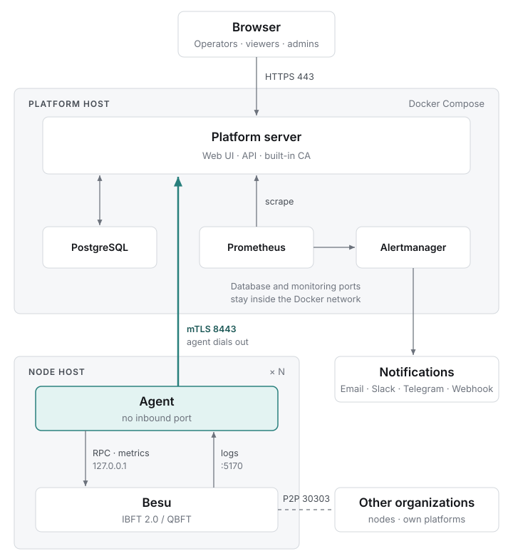

English | [繁體中文](README.zh-TW.md)

# BSOS Node Manager

BSOS Node Manager is a management platform for organizations that take part in a Hyperledger Besu consortium chain. Each organization deploys it on its own hosts to manage the nodes it runs: validator voting, node permissioning and RPC access, monitoring and alerts. Platforms of different organizations are independent; each issues its own certificates, and nothing goes through a central service.

## Features

- **Validator governance** – propose and vote on adding or removing validators (IBFT 2.0 and QBFT), and see each proposal's vote count and history.
- **Node permissions and access management** – manage the authorized sender addresses (Besu account allowlist), and issue scoped JWTs for applications that call node RPC.
- **Monitoring** – chain health, per-node status, peers, transaction pool and host metrics, with default alert rules and notifications by email, Telegram, Slack or webhook.
- **Node onboarding** – a one-line install puts an agent beside an existing Besu node. The platform does not install or configure Besu.
- **Built-in PKI** – each instance runs its own CA and issues short-lived mTLS certificates to its agents. The root key can be kept offline.

## How it works

<picture>
  <source media="(prefers-color-scheme: dark)" srcset=".github/assets/architecture-en-dark.svg">
  
</picture>

The agent opens no inbound port on the network. Its only listener is a loopback socket (127.0.0.1:5170) that receives Besu's logs. The platform reaches Besu's JSON-RPC through the agent's tunnel.

## Quick start

You need Docker with the Compose plugin on the platform host. Each node needs Linux (x86_64 or ARM64), a running Besu with JSON-RPC enabled, and systemd or Docker.

**1. Start the platform**

```bash
cd deploy/platform/docker-compose
./up.sh --org-id org-a.example --domain platform.example.com --acme --email ops@example.com
```

`up.sh` also accepts your own certificate (`--cert`, `--key`) or plain HTTP for testing (`--host <ip> --http`). On the first run in production, add `--offline-root` so the CA root key is not stored in the database. Run `./up.sh` with no arguments to restart with the saved settings. See [`deploy/platform/README.md`](deploy/platform/README.md).

**2. Add a node**

In the web UI, open **Node registration & settings**, choose **Register node** and copy the install command. Use the command from the UI: it also checks the SHA-256 of `install.sh` and sets `--platform-http`. It looks like this:

```bash
curl -fsSL https://<platform>/install.sh -o install.sh
sudo bash install.sh --platform <platform>:8443 --token <join-token> [--runtime systemd|docker]
```

Nodes must be able to reach the platform on port 8443. Besu must enable the ETH, NET and IBFT or QBFT RPC APIs. WEB3 (Besu version display), ADMIN (peer management, log level), TXPOOL (transaction pool view) and PERM (authorized sender addresses) are optional; without them only that feature is missing. The node page lists what is enabled. See [`deploy/agent/README.md`](deploy/agent/README.md).

## Repository layout

| Path | Contents |
|---|---|
| `backend/` | Platform server in Go: API, CA, collector. Serves the web UI from the same origin. |
| `agent/` | Node agent in Go. |
| `frontend/` | Web UI in React, TypeScript and Vite. |
| `contract/` | `openapi.yaml`, the single source of the API types used by the backend, agent and frontend. |
| `deploy/` | Docker Compose stack and agent install files. |

## Development

```bash
# Regenerate types after editing contract/openapi.yaml
(cd backend && make generate)
(cd agent && make generate)
(cd frontend && npm run gen:api)

# Build and test
(cd backend && go build ./... && go test ./...)
(cd agent && go test ./...)
(cd frontend && npm install && npm run build)

# UI against mock data, no backend needed: http://localhost:5173
(cd frontend && npm run dev)
```

Tests that need PostgreSQL are skipped unless `TEST_DATABASE_URL` is set (the database name must contain `test`). The mock UI accepts `admin`, `ops` and `viewer` with the password `BesuDemo-2026`.

Requires Go 1.26 and Node.js 22.

## Editions

This repository is the open-source Core edition. Cross-organization monitoring, SSO, audit logging and node failover are part of a separate commercial Enterprise edition.

## Contributing

Bug reports and pull requests are welcome. See [CONTRIBUTING.md](CONTRIBUTING.md) for the development setup, the sign-off requirement and how pull requests are merged, and follow the [Code of Conduct](CODE_OF_CONDUCT.md). Report security vulnerabilities privately as described in [SECURITY.md](SECURITY.md).

## License

Licensed under the [Apache License 2.0](LICENSE). Copyright 2026 BSOS. The license does not cover the BSOS name and logos; see [TRADEMARKS.md](TRADEMARKS.md).
