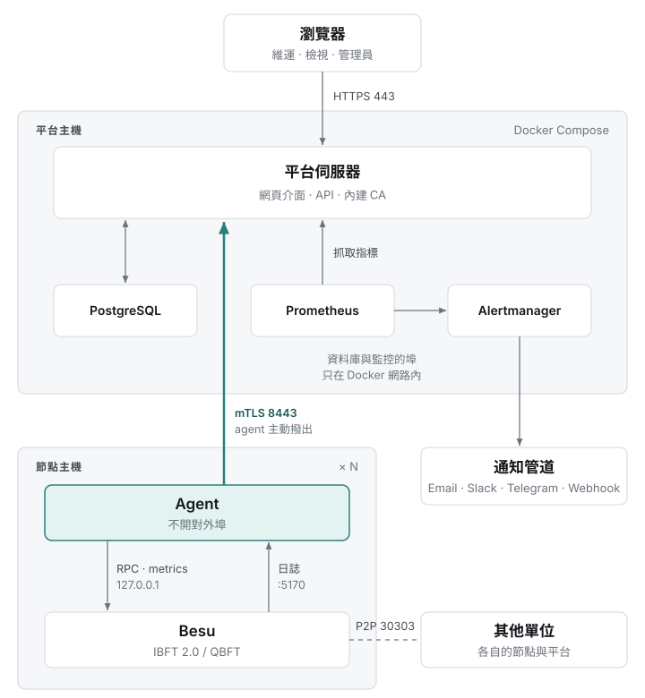

[English](README.md) | 繁體中文

# BSOS 節點治理工具

BSOS 節點治理工具是給 Hyperledger Besu 聯盟鏈參與單位用的管理平台。每個單位在自己的主機上部署一套，管理自家的節點：驗證者投票、節點權限與 RPC 存取、監控與告警。各單位的平台彼此獨立，憑證由各自的平台簽發，不經過任何中央服務。

## 功能

- **驗證者治理**：提案並投票增減驗證者（IBFT 2.0、QBFT），可看每個提案的票數與紀錄。
- **節點權限及存取管理**：管理交易地址授權，並發給呼叫節點 RPC 的應用程式限定範圍的 JWT。
- **監控**：全鏈健康、各節點狀態、peer、交易池與主機指標；內建預設告警規則，可用 Email、Telegram、Slack、webhook 通知。
- **節點接入**：一行指令在既有的 Besu 旁裝上 agent。平台不安裝、也不設定 Besu。
- **內建 PKI**：每套平台自帶 CA，發短效 mTLS 憑證給自家 agent；root 私鑰可離線保管。

## 運作方式

<picture>
  <source media="(prefers-color-scheme: dark)" srcset=".github/assets/architecture-zh-dark.svg">
  
</picture>

agent 不對網路開任何入站埠，唯一的監聽是收 Besu 日誌的 loopback 埠（127.0.0.1:5170）。平台經由 agent 的通道存取 Besu 的 JSON-RPC。

## 快速開始

平台主機需要 Docker 與 Compose 外掛。每個節點需要 Linux（x86_64 或 ARM64）、已在執行且開啟 JSON-RPC 的 Besu，以及 systemd 或 Docker。

**1. 啟動平台**

```bash
cd deploy/platform/docker-compose
./up.sh --org-id org-a.example --domain platform.example.com --acme --email ops@example.com
```

`up.sh` 也可以用自備憑證（`--cert`、`--key`），測試時可用純 HTTP（`--host <ip> --http`）。正式環境首次啟動時加 `--offline-root`，CA 的 root 私鑰就不會存進資料庫。不帶參數執行 `./up.sh` 會沿用既有設定重啟。詳見 [`deploy/platform/README.zh-TW.md`](deploy/platform/README.zh-TW.md)。

**2. 接入節點**

在網頁的「節點登錄與設定」按「登錄節點」，複製安裝指令。請用介面上的指令，它還會檢查 `install.sh` 的 SHA-256 並帶上 `--platform-http`。格式如下：

```bash
curl -fsSL https://<platform>/install.sh -o install.sh
sudo bash install.sh --platform <platform>:8443 --token <join-token> [--runtime systemd|docker]
```

節點要連得到平台的 8443 埠。Besu 必須開啟 ETH、NET，以及 IBFT 或 QBFT 的 RPC API。WEB3（顯示 Besu 版本）、ADMIN（peer 管理、日誌等級）、TXPOOL（交易池檢視）、PERM（交易地址授權）是選用，沒開只少那一項功能。開了哪些會列在節點頁上。詳見 [`deploy/agent/README.zh-TW.md`](deploy/agent/README.zh-TW.md)。

## 目錄結構

| 路徑 | 內容 |
|---|---|
| `backend/` | 平台 server（Go）：API、CA、collector；網頁介面也由它同源提供。 |
| `agent/` | 節點 agent（Go）。 |
| `frontend/` | 網頁介面（React、TypeScript、Vite）。 |
| `contract/` | `openapi.yaml`，後端、agent、前端共用的 API 型別來源。 |
| `deploy/` | Docker Compose 與 agent 安裝檔。 |

## 開發

```bash
# 改了 contract/openapi.yaml 之後重新產生型別
(cd backend && make generate)
(cd agent && make generate)
(cd frontend && npm run gen:api)

# 建置與測試
(cd backend && go build ./... && go test ./...)
(cd agent && go test ./...)
(cd frontend && npm install && npm run build)

# 用假資料跑介面，不需要後端：http://localhost:5173
(cd frontend && npm run dev)
```

需要 PostgreSQL 的測試，沒設 `TEST_DATABASE_URL` 時會略過（資料庫名稱須含 `test`）。假資料介面可用 `admin`、`ops`、`viewer` 登入，密碼都是 `BesuDemo-2026`。

需要 Go 1.26 與 Node.js 22。

## 版本

這個 repo 是開源版。跨單位監控、SSO、稽核紀錄與節點備援屬於另外的商業版。

## 參與貢獻

歡迎回報問題與送 pull request。開發環境、commit 簽署(sign-off)要求與 pull request 的合併方式見 [CONTRIBUTING.md](CONTRIBUTING.md),並請遵守[行為準則](CODE_OF_CONDUCT.md)。資安漏洞請照 [SECURITY.md](SECURITY.md) 私下回報。

## 授權

採用 [Apache License 2.0](LICENSE)。Copyright 2026 BSOS. 授權不包含 BSOS 名稱與 logo,見 [TRADEMARKS.md](TRADEMARKS.md)。
